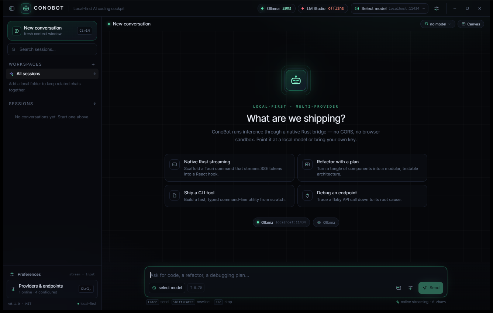

# ConoBot

[](https://github.com/indven-swe/conobot/releases/latest)
[](LICENSE)
[](https://tauri.app)

**A local-first, multi-provider AI coding cockpit — a real native desktop app.**

ConoBot pairs a Tauri v2 / Rust backend with a React + TypeScript + Tailwind workspace.
All model traffic runs through native Rust HTTP clients, so local servers and cloud
APIs behave identically and the browser CORS model never gets in the way.



## Download and install

Grab the newest build from **[Releases](https://github.com/indven-swe/conobot/releases/latest)**.

| Platform | File | Notes |
| --- | --- | --- |
| Windows 10/11 · x64 | `ConoBot_0.1.0_x64-setup.exe` | Recommended. Installs for the current user, no admin prompt. |
| Windows · x64 | `ConoBot_0.1.0_x64_en-US.msi` | MSI, for managed machines. |
| Windows · x64 | `ConoBot-portable.exe` | Single file, no installation. |
| macOS / Linux | build on the target machine | `npm run tauri:build` produces a `.dmg` or `.AppImage`/`.deb`; CI does this for every tagged release. |

The builds are **not code-signed**. On Windows, SmartScreen shows "Unknown publisher"
— choose **More info → Run anyway**. On macOS, right-click the app → **Open** the
first time.

### First run

1. Install and launch ConoBot.
2. It auto-detects **Ollama** on `http://localhost:11434`. No Ollama yet? Install it,
   then `ollama pull qwen2.5-coder`.
3. Press **Ctrl/Cmd + K** and pick a model.
4. Type a prompt, press **Enter**.

Closing the window keeps ConoBot running in the system tray so the
`Ctrl/Cmd + Shift + Space` shortcut keeps working. The first close explains this;
**Quit ConoBot** is in the tray menu.

```
┌──────────────────────────────────────────────────────────────────────┐
│  ConoBot                                             ● Ollama 4ms  ⌘K│
├───────────────┬──────────────────────────────────┬───────────────────┤
│  New chat     │  Chat + Markdown + code blocks   │  Code canvas      │
│  Workspaces   │  ─────────────────────────────   │  ▸ preview        │
│  Sessions     │  Composer  ⏎ send  Esc stop      │  ▸ source / save  │
└───────────────┴──────────────────────────────────┴───────────────────┘
```

## Highlights

- **Native streaming bridge** — `src-tauri/src/llm.rs` performs every request with
  `reqwest`, parses NDJSON (Ollama) and SSE (Anthropic / OpenAI-compatible) and emits
  `llm:chunk`, `llm:done`, `llm:error` events. Cancellation is a real
  `CancellationToken`, not an aborted fetch.
- **Four provider families** — Ollama with `/api/tags` discovery, LM Studio via
  `/v1/models`, Anthropic's Messages API, and any OpenAI-compatible endpoint
  (OpenAI, OpenRouter, vLLM, llama.cpp, Together, Groq, a proxy…).
- **Desktop-native persistence** — chats, sessions, workspace folders, endpoint
  profiles and API keys are stored in one JSON document in the OS app-data directory.
- **Frameless chrome** — custom titlebar, native minimize / maximize / close,
  live endpoint status pills, system tray, close-to-tray, and a global
  `Cmd/Ctrl + Shift + Space` quick summon.
- **Coding canvas** — side-by-side artifact panel with HTML/Markdown previews,
  syntax highlighting, one-click copy and native save-to-file dialogs.
- **Original icon system** — 35+ hand-authored SVGs in `src/components/Icons.tsx`
  (1.75 px strokes, rounded geometry, dual-tone mint accents). Nothing is traced
  from a third-party brand. The app icon is rasterised from the same geometry by
  `scripts/generate-icon.mjs` (SDF rendering + a dependency-free PNG encoder).

## Tech stack

| Layer      | Choice                                                        |
| ---------- | ------------------------------------------------------------- |
| Shell      | Tauri v2 (Rust 2021)                                          |
| Frontend   | React 18, TypeScript 5, Vite 6, Tailwind CSS 3                |
| Native I/O | `reqwest` + `futures-util` streaming, `tokio-util` cancellation |
| Markdown   | `react-markdown` + `remark-gfm` + `highlight.js`              |
| Plugins    | `tauri-plugin-dialog`, `tauri-plugin-global-shortcut`          |
| Storage    | Atomic JSON store in `app_data_dir`                           |

## Requirements

- **Node.js 20+** and npm
- **Rust 1.77.2+** via [rustup](https://rustup.rs)
- Platform toolchain:
  - **Windows**: Microsoft C++ Build Tools + WebView2 (Windows 10/11 ships WebView2)
  - **macOS**: Xcode Command Line Tools (`xcode-select --install`)
  - **Linux**: `libwebkit2gtk-4.1-dev`, `build-essential`, `curl`, `wget`, `file`,
    `libxdo-dev`, `libssl-dev`, `libayatana-appindicator3-dev`, `librsvg2-dev`

## Run from source

```bash
npm install
npm run tauri:dev      # hot-reload desktop app
```

The first Rust build takes a few minutes; later builds are incremental.

On Windows, if `cargo` is not on your PATH or the linker is not found, run
`scripts\cargo.cmd test` / `scripts\cargo.cmd check` — it locates Visual Studio
Build Tools and sources `vcvars64.bat` before invoking cargo.

### Browser-only UI preview

`npm run dev` renders the interface in a normal browser. In that mode the LLM client
falls back to `fetch`, which requires the endpoint to allow the dev origin. This is
only for UI work — use `tauri:dev` for real streaming.

## Build installers

```bash
npm run tauri:build
```

On Windows you can also double-click `scripts\build-windows.cmd`, which loads the
MSVC environment first and then runs the same build.

Artifacts land in `src-tauri/target/release/bundle/`:

| OS      | Output                                                               |
| ------- | -------------------------------------------------------------------- |
| Windows | `nsis/ConoBot_0.1.0_x64-setup.exe` and `msi/ConoBot_0.1.0_x64_en-US.msi` |
| macOS   | `dmg/ConoBot_0.1.0_aarch64.dmg` or `x64.dmg`, plus `macos/ConoBot.app`     |
| Linux   | `appimage/ConoBot_0.1.0_amd64.AppImage`, `deb/ConoBot_0.1.0_amd64.deb`     |

Target one bundle type: `npm run tauri build -- --bundles nsis` (or `dmg`, `appimage`).
Debug build with devtools: `npm run tauri:build:debug`.

The Windows artifacts from this checkout are mirrored in `release/`
(`ConoBot_0.1.0_x64-setup.exe`, `ConoBot_0.1.0_x64_en-US.msi`, `ConoBot-portable.exe`).

Unsigned Windows/macOS builds will trigger SmartScreen / Gatekeeper warnings.
For distribution, sign and notarize (`APPLE_CERTIFICATE`, `APPLE_ID`,
`APPLE_TEAM_ID`, `TAURI_SIGNING_PRIVATE_KEY`). `.github/workflows/release.yml`
builds all three platforms on a `v*` tag.

## Configure providers

Open **Providers & endpoints** (sidebar footer or `Cmd/Ctrl + ,`).

| Provider            | Base URL default          | Discovery             | Key |
| ------------------- | ------------------------- | --------------------- | --- |
| Ollama              | `http://localhost:11434`  | `GET /api/tags`       | no  |
| LM Studio           | `http://localhost:1234`   | `GET /v1/models`      | no  |
| Claude (Anthropic)  | `https://api.anthropic.com` | `GET /v1/models`    | yes |
| Custom OpenAI-compat| any root URL              | `GET /v1/models`      | optional |

- **Ollama**: `ollama serve`, then `ollama pull qwen2.5-coder`. ConoBot discovers every
  pulled model automatically.
- **LM Studio**: start the local server in the Developer tab, then press *discover*.
- **Claude**: paste an `sk-ant-…` key. Streaming uses `/v1/messages` with
  `anthropic-version: 2023-06-01`.
- **Custom**: the base URL may end with `/v1` or be a full `/chat/completions` URL;
  ConoBot normalises it. Keys are sent as `Authorization: Bearer …`.
- Use **Test connection** to probe an endpoint without saving, and the model switcher
  (`Cmd/Ctrl + K`) for a searchable cross-provider list. A custom model id can be typed
  directly when a server does not expose `/v1/models`.

## Keyboard shortcuts

| Action                  | Shortcut                    |
| ----------------------- | --------------------------- |
| Quick-switch model      | `Cmd/Ctrl + K`              |
| Provider settings       | `Cmd/Ctrl + ,`              |
| New conversation        | `Cmd/Ctrl + N`              |
| Toggle sidebar          | `Cmd/Ctrl + B`              |
| Toggle code canvas      | `Cmd/Ctrl + J`              |
| Send message            | `Enter` (`Cmd/Ctrl + Enter` if send-on-Enter is off) |
| Newline                 | `Shift + Enter`             |
| Stop generation         | `Esc` or Stop button        |
| Summon / hide window    | `Cmd/Ctrl + Shift + Space`  |

## Where data lives

| OS      | Path                                                            |
| ------- | --------------------------------------------------------------- |
| Windows | `%APPDATA%\dev.conobot.desktop\store.json`                        |
| macOS   | `~/Library/Application Support/dev.conobot.desktop/store.json`    |
| Linux   | `~/.local/share/dev.conobot.desktop/store.json`                   |

The store is written atomically (temp file + rename) and debounced by the UI.
Deleting the file resets the app. **API keys are stored as plain text in that file** —
the same trust model as `.env` files. Do not sync the folder to a shared drive; use
OS keychain integration if you need stronger at-rest protection. Keys are only sent
to the base URL of the endpoint that owns them.

## Project structure

```
conobot/
├─ package.json                 # scripts + frontend deps
├─ vite.config.ts               # aliases, port 1420, Tauri-friendly build
├─ tailwind.config.js           # obsidian palette, glow/motion tokens
├─ index.html
├─ scripts/generate-icon.mjs    # dependency-free icon rasteriser (SDF + PNG)
├─ scripts/cargo.cmd            # MSVC-wired cargo wrapper (Windows)
├─ scripts/build-windows.cmd    # MSVC-wired tauri build (Windows)
├─ public/logo.svg
├─ src/
│  ├─ main.tsx
│  ├─ App.tsx                   # shell, shortcuts, panels
│  ├─ types.ts
│  ├─ state/AppState.tsx        # reducer, persistence, streaming controller
│  ├─ services/
│  │  ├─ llmClient.ts           # Tauri command/event wrapper + browser fallback
│  │  └─ persistence.ts         # store I/O, native save dialog, folder picker
│  ├─ components/
│  │  ├─ Icons.tsx              # bespoke SVG icon library
│  │  ├─ TitleBar.tsx           # frameless chrome + status pills
│  │  ├─ Sidebar.tsx            # sessions, workspaces, search
│  │  ├─ ChatView.tsx           # empty state, transcript, scroll anchoring
│  │  ├─ MessageBubble.tsx      # markdown, actions, error/stream states
│  │  ├─ Markdown.tsx
│  │  ├─ CodeBlock.tsx          # highlight.js + copy/save
│  │  ├─ Composer.tsx
│  │  ├─ ArtifactPanel.tsx      # resizable canvas + sandboxed preview
│  │  ├─ ProviderSettingsModal.tsx
│  │  ├─ ModelSwitcher.tsx      # command palette
│  │  ├─ ConnectionPill.tsx
│  │  ├─ PreferencesMenu.tsx    # streaming, send-on-enter, global prompt
│  │  ├─ ToastStack.tsx
│  │  └─ ui/Modal.tsx
│  ├─ lib/                      # providers, artifacts, markdown helpers, utils
│  └─ styles/globals.css
└─ src-tauri/
   ├─ Cargo.toml
   ├─ tauri.conf.json
   ├─ capabilities/default.json
   ├─ icons/                    # generated from the brand emblem
   └─ src/
      ├─ main.rs                # window, tray, global shortcut, commands
      ├─ llm.rs                 # native HTTP/SSE bridge (unit tested)
      └─ store.rs               # atomic JSON persistence
```

## Native command surface

| Command             | Direction        | Purpose                                    |
| ------------------- | ---------------- | ------------------------------------------ |
| `start_chat_stream` | JS → Rust        | Begin a streamed completion                |
| `llm:chunk`         | Rust → JS        | Token delta `{ requestId, delta }`         |
| `llm:done`          | Rust → JS        | Final text, model, usage                   |
| `llm:error`         | Rust → JS        | Provider/transport error                   |
| `stop_generation`   | JS → Rust        | Cancel by request id                       |
| `test_connection`   | JS → Rust        | Probe endpoint, return models + latency    |
| `load_store`        | JS → Rust        | Read the JSON store                        |
| `save_store`        | JS → Rust        | Atomically replace the store               |
| `write_text_file`   | JS → Rust        | Write an artifact to a chosen path         |
| `open_external_url` | JS → Rust        | Open http(s)/mailto links in the OS        |

Provider traffic never touches the webview's network stack in release builds.

## Adding a provider

1. Add a preset in `src/lib/providers.ts` and a case in `PROVIDER_ICONS`.
2. In `src-tauri/src/llm.rs`, teach `build_request` the new wire format and
   `models_url`/`parse_models` where to discover models.
3. Reuse `Wire::Sse` if it speaks SSE with `data:` frames. Most providers do.

## Security notes

- The webview CSP allows inline styles/scripts so the sandboxed artifact preview can
  render standalone HTML. Previews run in an iframe **without** `allow-same-origin`,
  so they cannot reach Tauri IPC.
- React Markdown does not enable raw HTML (`rehype-raw` is intentionally absent).
- `open_external_url` only accepts `http`, `https` and `mailto`.
- The window hides to the tray on close; use **Quit ConoBot** from the tray menu.
- Linux global shortcuts require X11 or a desktop portal that supports
  `org.freedesktop.portal.GlobalShortcuts`.

## Tests & checks

```bash
npm run typecheck        # TypeScript
npm run build            # production frontend bundle
cd src-tauri && cargo test   # URL normalisation + stream parser tests
cd src-tauri && cargo clippy -- -D warnings
```

## License

MIT © 2026 ConoBot contributors. See [LICENSE](LICENSE).
